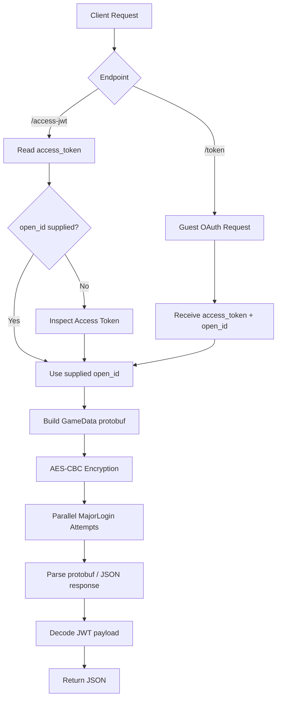

<div align="center">

# ⚡ JWT-OB54 API

### 🚀 Fast • Async • Protobuf • JWT • Free Fire Authentication API

<p>
  
  
  
  
</p>

<a href="https://github.com/Itz-Jahid-X/JWT-OB54">
  
</a>

<br>


</div>

---

## ✨ Overview

**JWT-OB54** is a Flask-based API project designed around a fast authentication/token workflow.

The application provides two main HTTP endpoints:

| Endpoint | Purpose |
|---|---|
| `GET /access-jwt` | Accepts an access token, resolves `open_id` when needed, then attempts to generate a JWT through the MajorLogin flow |
| `GET /token` | Accepts guest credentials, requests an OAuth access token, then continues into the JWT generation flow |

The implementation uses **Gevent concurrency**, **AES-CBC encryption**, **Protocol Buffers**, **PyJWT**, and HTTP connection pooling.

> ⚠️ **Important:** This project interacts with third-party game/authentication services. Use it only with accounts and credentials you are authorized to use, and follow the applicable service terms.

---

## 🧠 How It Works



---

## ⚡ Key Features

### 🚀 Concurrent platform attempts
Multiple platform values are attempted concurrently using **Gevent**, allowing the first successful response to be used.

### 🔐 AES encrypted payload
The serialized game data is encrypted using **AES-CBC** before being sent to the MajorLogin endpoint.

### 📦 Protocol Buffers
Game data is serialized through the generated protobuf modules:

```text
my_pb2.py
output_pb2.py
```

### 🌐 Connection pooling
A shared `requests.Session()` uses an HTTP adapter with connection pooling to reduce repeated connection overhead.

### 🧾 JWT parsing
The returned JWT is decoded to extract useful fields such as:

```text
account_id
nickname
external_type
lock_region
token
```

### 🪶 Lightweight JSON responses
`orjson` is used when available, with a standard-library JSON fallback.

---

## 📁 Project Structure

```text
JWT-OB54/
│
├── app.py              # Main Flask application
├── my_pb2.py           # Generated protobuf definitions
├── output_pb2.py       # Generated response protobuf definitions
├── requirements.txt    # Python dependencies
├── vercel.json         # Deployment configuration
├── README.md           # Project documentation
└── .gitignore          # Recommended: keep secrets/cache out of Git
```

---

## 🛠️ Installation

### 1. Clone the repository

```bash
git clone https://github.com/Itz-Jahid-X/JWT-OB54.git
cd JWT-OB54
```

### 2. Create a virtual environment

**Windows:**

```bash
python -m venv venv
venv\Scripts\activate
```

**Linux / macOS:**

```bash
python3 -m venv venv
source venv/bin/activate
```

### 3. Install dependencies

```bash
pip install -r requirements.txt
```

### 4. Start the API

```bash
python app.py
```

The local server starts on:

```text
http://127.0.0.1:1080
```

---

## 🔥 API Usage

### 🌐 Base URL

After deploying the project, replace `YOUR_DOMAIN` with your API domain:

```text
https://YOUR_DOMAIN
```

---

### 🔑 1. Access Token → JWT

This is the main **Access Token → JWT** API.

#### API Format

```http
GET /access-jwt?access_token=YOUR_ACCESS_TOKEN
```

#### Full URL

```text
https://YOUR_DOMAIN/access-jwt?access_token=YOUR_ACCESS_TOKEN
```

#### With `open_id`

```http
GET /access-jwt?access_token=YOUR_ACCESS_TOKEN&open_id=YOUR_OPEN_ID
```

#### Full URL

```text
https://YOUR_DOMAIN/access-jwt?access_token=YOUR_ACCESS_TOKEN&open_id=YOUR_OPEN_ID
```

#### Parameters

| Parameter | Required | Description |
|---|---|---|
| `access_token` | ✅ Yes | Valid access token |
| `open_id` | ❌ No | OpenID; can be supplied directly |

#### Example

```bash
curl "https://YOUR_DOMAIN/access-jwt?access_token=YOUR_ACCESS_TOKEN"
```

#### Success Response

```json
{
  "status": "success",
  "account_id": "ACCOUNT_ID",
  "account_name": "PLAYER_NAME",
  "open_id": "OPEN_ID",
  "access_token": "ACCESS_TOKEN",
  "platform": "PLATFORM",
  "region": "REGION",
  "token": "JWT_TOKEN"
}
```

> 💡 **Flow:** `ACCESS_TOKEN → OPEN_ID → MAJORLOGIN → JWT`

---

### 👤 2. UID + Password → JWT

The `/token` endpoint starts from guest credentials and continues through the OAuth → JWT workflow.

#### API Format

```http
GET /token?uid=YOUR_UID&password=YOUR_PASSWORD
```

#### Full URL

```text
https://YOUR_DOMAIN/token?uid=YOUR_UID&password=YOUR_PASSWORD
```

#### Parameters

| Parameter | Required | Description |
|---|---|---|
| `uid` | ✅ Yes | Authorized account UID |
| `password` | ✅ Yes | Authorized account credential |

#### Example

```bash
curl "https://YOUR_DOMAIN/token?uid=YOUR_UID&password=YOUR_PASSWORD"
```

> 🔒 **Security:** Never put real passwords, access tokens, cookies, client secrets, or JWTs into public README files, screenshots, Git commits, or issue reports.

---

### ⚡ Quick API Reference

```text
ACCESS TOKEN → JWT
GET https://YOUR_DOMAIN/access-jwt?access_token=YOUR_ACCESS_TOKEN

ACCESS TOKEN + OPEN ID → JWT
GET https://YOUR_DOMAIN/access-jwt?access_token=YOUR_ACCESS_TOKEN&open_id=YOUR_OPEN_ID

UID + PASSWORD → OAuth → JWT
GET https://YOUR_DOMAIN/token?uid=YOUR_UID&password=YOUR_PASSWORD
```

---

## ⚙️ Production

For a Gunicorn + Gevent deployment, the project includes a recommended command:

```bash
gunicorn -k gevent -w 4 --worker-connections 1000 --max-requests 10000 --max-requests-jitter 1000 app:app
```

Tune worker and connection settings according to your server resources and traffic.

---

## 📦 Dependencies

```text
Flask
requests
gevent
pycryptodome
PyJWT
protobuf
orjson
gunicorn
```

Install everything with:

```bash
pip install -r requirements.txt
```

---

## 🛡️ Security Checklist

Before pushing or deploying this project publicly:

- [ ] Remove hardcoded cookies/session values
- [ ] Move secrets to environment variables
- [ ] Rotate any credential that has already been exposed
- [ ] Never log access tokens or passwords
- [ ] Add rate limiting
- [ ] Add authentication for private deployments
- [ ] Use HTTPS in production
- [ ] Keep generated protobuf files version-controlled
- [ ] Add `.env` and cache folders to `.gitignore`

### Recommended `.gitignore`

```gitignore
__pycache__/
*.pyc
.env
venv/
.venv/
*.log
```

---

## 🎨 Animated Tech Stack

<div align="center">


<br><br>


</div>

---

## 📊 Architecture Highlights

```text
                   ┌───────────────────┐
                   │      Client       │
                   └─────────┬─────────┘
                             │
                     HTTP GET Request
                             │
              ┌──────────────┴──────────────┐
              │                             │
        /access-jwt                      /token
              │                             │
              ▼                             ▼
       Access Token                  OAuth Guest Flow
              │                             │
              └──────────────┬──────────────┘
                             ▼
                        open_id
                             │
                             ▼
                    GameData / Protobuf
                             │
                             ▼
                       AES Encryption
                             │
                             ▼
                  Parallel MajorLogin Calls
                             │
                             ▼
                    JWT / Response Parse
                             │
                             ▼
                       JSON Response
```

---

## ⚠️ Disclaimer

This repository is provided for **educational and authorized development purposes**.

The author is not responsible for misuse, account issues, service interruptions, rate-limit violations, or consequences resulting from unauthorized access or automation.

Use the project responsibly and comply with the terms and policies of any third-party service you interact with.

---

<div align="center">

### ⭐ If this project helped you, consider starring the repository!

<a href="https://github.com/Itz-Jahid-X/JWT-OB54">
  
</a>
<a href="https://github.com/Itz-Jahid-X/JWT-OB54/forks">
  
</a>

<br><br>


</div>
